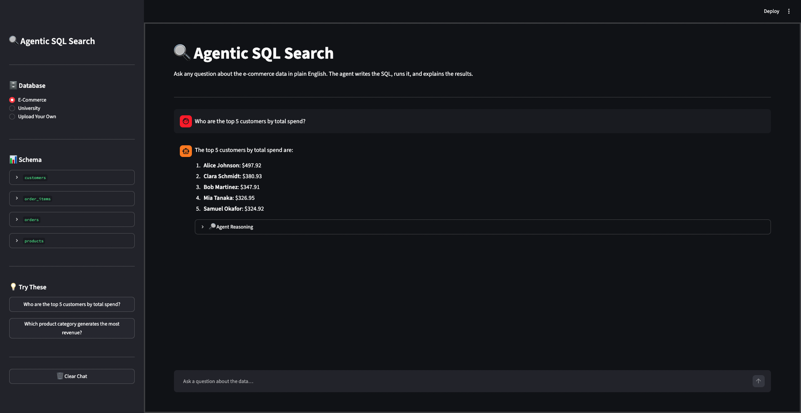

# Agentic SQL Search



Ask questions about a database in plain English. The app uses an AI agent to query SQLite data.

## 1. Requirements

- Python 3.12+
- An API key and environment settings required by the LLM provider configured in the app

## 2. Clone the repository

```bash
git clone <your-repository-url>
cd agentic_sql_search
```

## 3. Install uv

If `uv` is not installed:

**macOS / Linux**
```bash
curl -LsSf https://astral.sh/uv/install.sh | sh
```

**Windows (PowerShell)**
```powershell
powershell -ExecutionPolicy ByPass -c "irm https://astral.sh/uv/install.ps1 | iex"
```

Installation guide: https://docs.astral.sh/uv/getting-started/installation/

## 4. Configure and install

Create a `.env` file in the project root and add the API key/settings required by the app. Do not commit this file.

Install project dependencies:

```bash
uv sync
```

## 5. Run the application

```bash
uv run streamlit run app.py
```

Open the local URL printed in the terminal. The built-in databases should be initialized by the app on startup.

**Optional — without uv:** create and activate a Python virtual environment, install the dependencies from `pyproject.toml`, then run `streamlit run app.py`.

## 6. Use another database

- **Built-in datasets:** choose a dataset such as E-Commerce or University from the app.
- **Upload your own:** choose **Upload Your Own** and upload a SQLite database file (`.db`, `.sqlite`, or `.sqlite3`). The app uses the uploaded database for your session.

## 7. Add a built-in dataset

Example: adding an Employee database.

1. Create `database_setup/employee_database.py`. Define the tables and sample data, and add an `init_employee_db()` function to create and seed the database.
2. Save its database in the shared root `data/` directory. Use this path pattern in the module:

   ```python
   from pathlib import Path

   DATA_DIR = Path(__file__).resolve().parent.parent / "data"
   EMPLOYEE_DB_PATH = DATA_DIR / "employee.db"
   ```

3. Register and initialize it: call `init_employee_db()` during startup alongside the existing initializers, then add an **Employee** entry to the dataset configuration in `app.py`. Follow the existing E-Commerce and University entries for the expected fields (database path and example questions).
4. Run the app and select **Employee**.

Keep each dataset's schema, sample data, and initialization function in its own module.

## Notes

- Local databases and `.env` are excluded from Git; the app creates built-in databases locally on startup.
- To recreate a sample database after changing its schema, stop the app and delete that database file from `data/` before restarting. This removes its local data.
