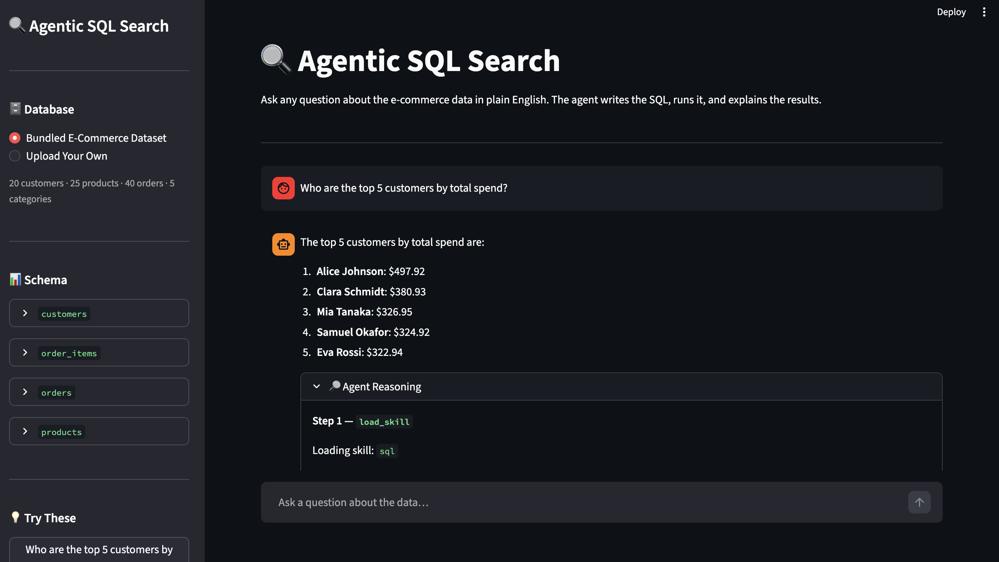

# 🔍 Agentic SQL Search

> Ask a question in plain English. The agent inspects the selected database schema, writes and runs SQL, and returns a clear answer.



## Overview

Agentic SQL Search is a natural-language-to-SQL app that lets you query SQLite databases without writing SQL yourself. Before answering, the agent loads SQL guidance, inspects the live schema to confirm table and column names, and executes an appropriate query. The Streamlit UI lets you inspect the agent's tool calls and results.

## Features

- **Natural-language queries:** Ask questions in plain English.
- **Skill-based reasoning:** Loads `skills/sql.md` for SQL syntax rules and query patterns.
- **Live schema inspection:** Checks the selected database instead of guessing column names.
- **Agent trace:** View tool calls, queries, and results in the UI.
- **Built-in datasets:** Includes E-Commerce and University sample databases, created locally on startup.
- **Bring your own database:** Upload a `.db`, `.sqlite`, or `.sqlite3` file and query it.
- **Sample questions:** Use the sidebar suggestions to get started.

## Tech Stack

- [LangGraph](https://langchain-ai.github.io/langgraph/) — ReAct agent workflow
- [LangChain](https://python.langchain.com/) — model integration and tool definitions
- [Streamlit](https://streamlit.io/) — interactive chat UI
- Google Gemini API — language model access
- SQLite — built-in and uploaded databases
- [uv](https://docs.astral.sh/uv/) — Python environment and dependency management

## How It Works

```text
User question
     |
     v
load_skill("sql")   -> Load SQL rules and query patterns
     |
     v
get_schema()        -> Inspect live tables and columns
     |
     v
execute_sql(query)  -> Run the generated SELECT query
     |
     v
Answer + agent trace
```

**Tools**

- `load_skill`: reads `skills/sql.md` for SQL rules and query patterns.
- `get_schema`: inspects the selected database's live schema.
- `execute_sql`: executes a generated `SELECT` query and returns the results.

## Datasets

### E-Commerce

| Table | Description |
|---|---|
| `customers` | 20 customers across 10 countries |
| `products` | 25 products across 5 categories |
| `orders` | 40 orders with different statuses |
| `order_items` | 78 line items connecting orders and products |

Categories include Electronics, Clothing, Books, Home & Garden, and Sports.

### University

| Table | Description |
|---|---|
| `departments` | University departments |
| `students` | Student details and departments |
| `courses` | Courses and credits |
| `enrollments` | Student course enrollments and grades |
| `professors` | Professor details and departments |

Both built-in databases are generated locally in `data/` when the app initializes; you don't need to commit or create the `.db` files yourself.

## Requirements

- Python 3.12 or later
- [uv](https://docs.astral.sh/uv/)
- A Google AI Studio API key

### Install uv (if needed)

**macOS / Linux**

```bash
curl -LsSf https://astral.sh/uv/install.sh | sh
```

**Windows (PowerShell)**

```powershell
powershell -ExecutionPolicy ByPass -c "irm https://astral.sh/uv/install.ps1 | iex"
```

See the [uv installation guide](https://docs.astral.sh/uv/getting-started/installation/) for other options.

## Setup

### 1. Clone the repository

Use your repository URL:

```bash
git clone https://github.com/saikrishna6297/agentic_sql_search.git
cd agentic_sql_search
```

### 2. Configure your API key

If `.env.example` is included, copy it to create your local `.env` file:

```bash
cp .env.example .env
```

On Windows Command Prompt, use `copy .env.example .env`.

Add your key to `.env`:

```env
GEMINI_API_KEY=your_google_ai_studio_key_here
```

Create a key at [Google AI Studio](https://aistudio.google.com/app/apikey). Keep `.env` private and never commit your API key.

### 3. Install dependencies

```bash
uv sync
```

This creates the project's virtual environment and installs the dependencies from `pyproject.toml` and `uv.lock`.

## Run the App

```bash
uv run streamlit run app.py
```

Open the local URL shown in the terminal, usually [http://localhost:8501](http://localhost:8501).

### Optional: run without uv

Install Python 3.12+, create and activate a virtual environment, install the project's dependencies, then run:

```bash
streamlit run app.py
```

## Use Your Own Database

1. Select **Upload Your Own** in the sidebar.
2. Upload a valid SQLite `.db`, `.sqlite`, or `.sqlite3` file.
3. Ask questions about its tables and data. The agent inspects the schema for you.

## Add Another Built-in Database

For example, to add `employee_database.py`:

1. **Create `database_setup/employee_database.py`.** Define the employee tables and sample records, and add an initialization function such as `init_employee_db()`.
2. **Save the database under the shared `data/` directory.** Use the same path pattern as the other database modules:

   ```python
   from pathlib import Path

   DATA_DIR = Path(__file__).resolve().parent.parent / "data"
   EMPLOYEE_DB_PATH = DATA_DIR / "employee.db"
   ```

3. **Initialize it at startup.** Call `init_employee_db()` alongside the existing database initialization functions.
4. **Add it to the dataset selector in `app.py`.** Register a display name and the `employee.db` path, and add a few example questions following the existing dataset configuration.
5. **Restart and test.** Select Employee in the sidebar and ask a question.

Keep each dataset's schema, seed data, path, and initialization function in its own module. Adding a built-in dataset requires connecting its initializer and registering it in the UI.

## Example Questions

Try these with E-Commerce:

- Who are the top 5 customers by total spend?
- Which product category generates the most revenue?
- What is the average order value per country?
- Which customers placed more than 2 orders?

## Project Structure

```text
agentic_sql_search/
├── app.py
├── agent.py
├── database_setup/
│   ├── __init__.py
│   ├── ecommerce_database.py
│   └── university_database.py
├── skills/
│   └── sql.md
├── assets/
│   └── demo.png
├── data/                   # Local databases; generated and gitignored
├── .env.example
├── .gitignore
├── pyproject.toml
├── uv.lock
└── README.md
```

## Contributing

Contributions are welcome! Feel free to open an issue or submit a pull request.

## License

This project is licensed under the MIT License. See the repository's `LICENSE` file for details.

---

[⬆ Back to Top](#-agentic-sql-search)
